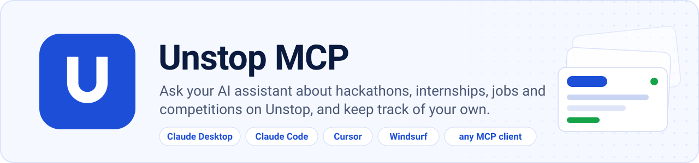
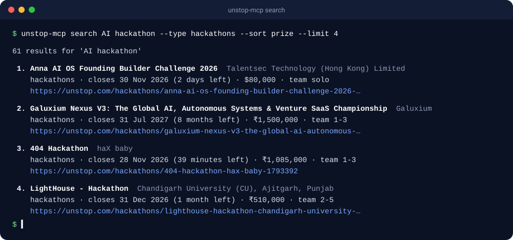
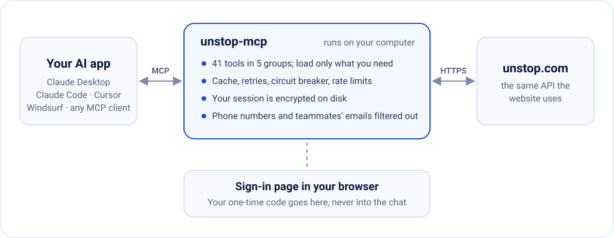

<p align="center">
  
</p>

<p align="center">
  <a href="https://github.com/vinoth322006/unstop-mcp-server/actions/workflows/ci.yml"></a>
  <a href="https://github.com/vinoth322006/unstop-mcp-server/releases/latest"></a>
  
  
  <a href="https://modelcontextprotocol.io"></a>
  <a href="LICENSE"></a>
</p>

<p align="center">
  <a href="#install"><b>Install</b></a> ·
  <a href="#what-you-can-ask">What you can ask</a> ·
  <a href="#tools">Tools</a> ·
  <a href="#privacy-and-security">Privacy</a> ·
  <a href="#run-it-for-a-team">Team server</a> ·
  <a href="INSTALL.md">Install guide</a> ·
  <a href="CHANGELOG.md">Changelog</a>
</p>

**Unstop MCP** connects your AI assistant to [Unstop](https://unstop.com), India's platform for hackathons, competitions,
internships, jobs and scholarships. Ask in plain words, and your assistant searches live listings, checks whether you're
eligible, lists what's due this week, tracks your registrations and team, and can even register you for simple free
events, always after showing you what it will submit.

- **Real, live data.** Uses the same endpoints as unstop.com. Nothing is mocked.
- **Your own account.** Sign in once with Unstop's one-time code, on a page in your browser. No password is stored.
- **Safe by default.** Anything that changes your account asks first. Phone numbers and teammates' emails never reach the AI.
- **Works where you are.** Claude Desktop, Claude Code, Cursor, Windsurf, and any other [MCP](https://modelcontextprotocol.io) client.

---

## Install

**Claude Desktop on Windows:** download **`unstop-mcp-<version>.mcpb`** from the
[latest release](https://github.com/vinoth322006/unstop-mcp-server/releases/latest) and double-click it. That's all.

**Windows, any AI app** (no Python needed):

```powershell
irm https://raw.githubusercontent.com/vinoth322006/unstop-mcp-server/master/get.ps1 | iex
```

**macOS / Linux:**

```sh
curl -LsSf https://raw.githubusercontent.com/vinoth322006/unstop-mcp-server/master/get.sh | sh
```

**Already use uv or pipx?**

```sh
uv tool install git+https://github.com/vinoth322006/unstop-mcp-server   # or: pipx install git+https://…
unstop-mcp setup
```

A portable `.exe`, pip, from-source and Docker are covered in **[INSTALL.md](INSTALL.md)**.

The installers end with a short guided setup. It checks that Unstop is reachable, signs you in (optional), and connects
the AI apps it finds, keeping your existing settings and making a backup first. **Restart your AI app** and start asking.

To sign in later, ask your assistant *"Sign me in to Unstop"*. A secure page opens in your browser, and your code never
goes through the chat.

---

## What you can ask

<table>
<tr>
<td width="50%" valign="top">

**Find**
- *"Find AI hackathons that close this week"*
- *"Free online quizzes for 2nd-year students"*
- *"Compare these three internships for me"*
- *"Who organises this, and what else do they run?"*

**Plan**
- *"What are my upcoming Unstop deadlines?"*
- *"Put my deadlines in my calendar"*
- *"Am I eligible for this one?"*
- *"Tell me when new ML competitions appear"*

</td>
<td width="50%" valign="top">

**Track**
- *"How am I doing on Unstop?"*
- *"Did I finish registering for everything?"*
- *"Which round am I in for this hackathon?"*
- *"Any new notifications or results?"*

**Act** (always previewed, then your yes)
- *"Register me for this quiz"*
- *"Who's on my team, and how many spots are left?"*
- *"Invite my teammate from last time"*
- *"Save this listing to my watchlist"*

</td>
</tr>
</table>

It works from a terminal too. This is real output, with the URLs shortened:

<p align="center">
  
</p>

---

## Tools

41 tools in five groups. All of them load by default. To keep your assistant's tool list short, load only the groups you
want (see [Load only what you need](#load-only-what-you-need)).

| Group | Tools |
|---|---|
| **always on** | `sign_in` · `sign_out` · `auth_status` · `server_status` |
| **discover** | `search_opportunities` · `get_opportunity` · `compare_opportunities` · `closing_soon` · `get_organisation` · `unstop_leaderboard` |
| **account** | `my_deadlines` · `save_deadlines_calendar` · `my_snapshot` · `my_profile` · `check_eligibility` · `recommended_for_me` · `my_registrations` · `my_participation` · `my_certificates` · `my_watchlist` · `add_to_watchlist` · `remove_from_watchlist` · `my_notifications` · `mark_notifications_read` · `my_courses` |
| **alerts** | `save_search` · `check_saved_searches` · `list_saved_searches` · `delete_saved_search` |
| **registration** | `prepare_registration` · `register_for_opportunity` · `cancel_registration` |
| **teams** | `my_team` · `suggest_teammates` · `invite_teammate` · `team_invitations` · `respond_to_invitation` · `respond_to_join_request` · `cancel_invitation` · `remove_team_member` · `leave_team` |

**discover** and **alerts** work without signing in (saved searches are kept on your computer). **account**,
**registration** and **teams** need you to be signed in.

It also includes three ready-made prompts (**Find opportunities for me**, **What's due soon** and **Plan my week on
Unstop**), and your deadlines as a calendar resource (`unstop://me/deadlines.ics`).

<details>
<summary><b>What each tool does</b></summary>

| Ask about… | Tool |
|---|---|
| Finding opportunities by keyword, type, fee and mode | `search_opportunities` |
| Everything about one listing: prizes, rounds, eligibility, job details | `get_opportunity` |
| Putting 2–5 listings side by side | `compare_opportunities` |
| What closes in the next few days | `closing_soon` |
| An organiser or company, and their other listings | `get_organisation` |
| Unstop's global points leaderboard | `unstop_leaderboard` |
| **What's due soon**: live rounds, unfinished registrations, watchlist items closing | `my_deadlines` |
| Your deadlines as a calendar file (Google Calendar, Outlook, Apple Calendar) | `save_deadlines_calendar` |
| Your Unstop at a glance: registrations by type, wins, certificates, coins, next deadline | `my_snapshot` |
| **Am I eligible?** Your profile checked against the listing's rules | `check_eligibility` |
| Unstop's personalised picks for you | `recommended_for_me` |
| Everything you've registered for, and whether each one is complete | `my_registrations` |
| Your status in each round of one event | `my_participation` |
| Your certificates, with links | `my_certificates` |
| Your watchlist, and saving or removing a listing | `my_watchlist`, `add_to_watchlist`, `remove_from_watchlist` |
| Notifications (results, registrations, team activity), and marking them read | `my_notifications`, `mark_notifications_read` |
| Your enrolled courses and progress | `my_courses` |
| **Alerts**: save a search, then later ask "anything new?" | `save_search`, `check_saved_searches`, `list_saved_searches`, `delete_saved_search` |
| **Registering you** for free, simple events, with a preview first | `prepare_registration`, `register_for_opportunity`, `cancel_registration` |
| **Your team**: members, invites by email or past teammate, invitations and join requests, removing or leaving | `my_team`, `suggest_teammates`, `invite_teammate`, `team_invitations`, `respond_to_invitation`, `respond_to_join_request`, `cancel_invitation`, `remove_team_member`, `leave_team` |

**Registering:** it only registers you for free events that need nothing beyond your Unstop profile, and it always
shows what it will submit and waits for your yes. Events with fees, custom questions, resumes, ID or face checks,
proctoring, or a minimum team size come back with a link to finish on unstop.com.

</details>

### Load only what you need

```sh
unstop-mcp connect claude-desktop --toolsets discover,account
unstop-mcp setup --toolsets discover,alerts
```

You can also set `UNSTOP_MCP_TOOLSETS=discover,account` in any app's server config, or use the **Tool groups** setting
in the Claude Desktop extension. A misspelt group name is refused before any config file is touched.

---

## How it works

<p align="center">
  
</p>

<table>
<tr>
<td width="33%" valign="top">

**Reliable**
- Retries with backoff and jitter, honouring `Retry-After`
- Circuit breaker: fails fast when Unstop is down, recovers by itself
- Serves recent public listings during an outage
- Partial results with a note when one source fails
- Sessions renew themselves before they expire

</td>
<td width="33%" valign="top">

**Fast**
- Shared connection pool
- Caches: 5 min for public data, 30 s for your account
- Identical requests at the same moment share one call
- Parallel fetches, with a cap
- Unstop's 150+ raw fields trimmed to what matters, which saves tokens

</td>
<td width="33%" valign="top">

**Tested**
- 260+ offline tests, plus live smoke tests
- Chaos tests: every tool against 12 kinds of broken responses and 17 hostile inputs
- CI on Windows, macOS and Linux × Python 3.11–3.13
- Release build checked on every push
- Typed throughout: mypy and ruff clean

</td>
</tr>
</table>

---

## Privacy and security

- **Your one-time code** goes into a page served on `127.0.0.1` that only your computer can open. It is never typed
  into the chat and never stored. The page accepts only its own address, and it stops working after you sign in or
  after a timeout.
- **Sessions are encrypted at rest** (Fernet: AES with HMAC), in files only your user account can read.
- **Privacy filter:** your phone number and your teammates' emails come back from Unstop but are never passed to the
  AI. Tests enforce this.
- **Nothing changes without your yes.** Registering, inviting and leaving a team are previewed first. Set
  `UNSTOP_MCP_ENABLE_WRITE_TOOLS=false` to hide every tool that changes your account.
- **Server mode** needs API keys. They are 256-bit random keys, stored only as SHA-256 hashes and checked in constant
  time; each has read or write scopes, an optional expiry, and can be revoked instantly. Server mode also has
  per-user rate limits, a write audit log, Host and Origin checks against DNS rebinding, and secrets redacted from
  logs. It refuses to start without an explicit encryption key.

Found a security problem? Please report it privately, as described in [SECURITY.md](SECURITY.md).

---

## Use it from the terminal

```sh
unstop-mcp search AI hackathon --sort prize      # live listings
unstop-mcp closing --days 3 --type hackathons    # what closes soon
unstop-mcp me                                    # your registrations, wins, coins and next deadline
unstop-mcp deadlines --ics my-deadlines.ics      # import into Google Calendar, Outlook or Apple Calendar
unstop-mcp inbox --unread                        # notifications
unstop-mcp alerts --add "AI hackathons" AI --type hackathons
unstop-mcp alerts                                # what's new since last time
```

| Command | What it does |
|---|---|
| `unstop-mcp setup` | Guided setup (safe to run again) |
| `unstop-mcp login --browser` / `logout` | Sign in on a browser page, or sign out |
| `unstop-mcp connect <app>` | Connect `claude-desktop`, `claude-code`, `cursor`, `windsurf` or `all`. Add `--remove` to undo |
| `unstop-mcp doctor` | Checks the connection, your sign-in and every app, and tells you how to fix anything wrong |

### Something not working?

Run `unstop-mcp doctor` first.

| You see | Do this |
|---|---|
| "Not logged in to Unstop" | Ask *"Sign me in to Unstop"*, or run `unstop-mcp login --browser` |
| Your AI app doesn't show Unstop | `unstop-mcp connect all`, then fully quit and reopen the app |
| "Unstop is not responding right now" | Unstop is having trouble. It retries by itself within a minute |
| "Too many requests" | Wait a minute. A per-user limit protects your account |

Still stuck? [Open an issue](https://github.com/vinoth322006/unstop-mcp-server/issues/new/choose).

---

## Run it for a team

One server, many people. Each person gets their own **tenant**: their own Unstop sign-in and their own API key, which
only ever acts as them.

```sh
docker run -d --name unstop-mcp -p 127.0.0.1:8000:8000 -v unstop-data:/data \
  -e UNSTOP_MCP_SECRET_KEY="<a Fernet key>" ghcr.io/vinoth322006/unstop-mcp:latest
docker exec -it unstop-mcp unstop-mcp login --tenant asha
docker exec -it unstop-mcp unstop-mcp keys create --tenant asha --scopes unstop:read,unstop:write
```

Clients connect to `https://your-host/mcp` with `Authorization: Bearer usk_…`:

```sh
claude mcp add --transport http unstop https://mcp.example.com/mcp --header "Authorization: Bearer usk_..."
```

To generate a key, run `python -c "from cryptography.fernet import Fernet; print(Fernet.generate_key().decode())"`. Put
a TLS proxy (Caddy, nginx or Cloudflare Tunnel) in front. `GET /healthz` reports `ok` or `degraded`. Manage keys with
`keys list`, `keys revoke <id>` and `keys create --ttl-days 90`; changes apply without a restart. A hardened
[`docker-compose.yml`](docker-compose.yml) is included (read-only filesystem, non-root user, all capabilities dropped).

<details>
<summary><b>All settings</b></summary>

Environment variables, or a `.env` file (see [.env.example](.env.example)).

| Variable | Default | Purpose |
|---|---|---|
| `UNSTOP_MCP_TRANSPORT` | `stdio` | `stdio` (desktop apps) or `http` (server) |
| `UNSTOP_MCP_TOOLSETS` | `all` | Tool groups to load: `discover`, `account`, `alerts`, `registration`, `teams` |
| `UNSTOP_MCP_ENABLE_WRITE_TOOLS` | `true` | `false` hides every tool that changes your account |
| `UNSTOP_MCP_SECRET_KEY` | generated file | Encrypts stored sessions. **Required** for `http` |
| `UNSTOP_MCP_PUBLIC_URL` | – | External URL (also added to the Host allow-list) |
| `UNSTOP_MCP_DATA_DIR` | `~/.unstop-mcp` | Sessions, keys, saved searches |
| `UNSTOP_MCP_CLIENT_RATE_LIMIT_PER_MINUTE` | `120` | Tool calls per user per minute |
| `UNSTOP_MCP_RATE_LIMIT_PER_SECOND` | `4` | Total requests to Unstop |
| `UNSTOP_MCP_CACHE_TTL_SECONDS` / `PRIVATE_CACHE_TTL_SECONDS` | `300` / `30` | Cache freshness |
| `UNSTOP_MCP_STALE_CACHE_SECONDS` | `3600` | How long stale public data may be served during an outage |
| `UNSTOP_MCP_BREAKER_THRESHOLD` / `BREAKER_COOLDOWN_SECONDS` | `5` / `30` | Circuit breaker |

</details>

---

## Development

```sh
git clone https://github.com/vinoth322006/unstop-mcp-server && cd unstop-mcp-server
pip install -e ".[dev]"
pytest -m "not live"      # offline suite
pytest -m live            # against the real Unstop API (read-only)
ruff check src tests packaging && mypy src
python packaging/build_release.py   # wheel, sdist, and on Windows the .exe and .mcpb
```

<details>
<summary><b>Project layout</b></summary>

Each layer imports only the ones below it.

```
src/unstop_mcp/
  cli/          one module per command group: setup/connect/doctor · account · discover · keys · serve
  server.py     builds the MCP server from the chosen tool groups; resources and prompts
  tools/        one module per tool group, each with its own instructions
                _common.py: ToolGuard (rate limit, errors, logging), scopes, audit log
  client/       Unstop operations, layered: catalog → account/alerts → registration → teams
  models/       schemas.py (what tools return) · normalize.py (type-safe parsing of raw Unstop JSON)
  runtime.py    shared HTTP client, session store and cache
  http.py       pool · cache + stale-if-error · single-flight · circuit breaker · token bucket · retries
  weblogin.py   the local sign-in page
  clients.py    finds AI apps and safely merges their config files
  auth/         one-time-code login and refresh · encrypted session store · hashed API keys
```

The Unstop endpoints used, and how this project differs from the original mock-data version, are documented in
[docs/ANALYSIS.md](docs/ANALYSIS.md).

</details>

Contributions are welcome. [CONTRIBUTING.md](CONTRIBUTING.md) covers setup, tests and how to add a tool.

---

## Good to know

- Unstop has no official public API. This uses the same endpoints as unstop.com, so they can change. If that happens
  you get a clear error, and `unstop-mcp doctor` shows what broke.
- Only the account owner should sign in. Never share your one-time code.
- Unofficial. Not affiliated with or endorsed by Unstop.

## License

[MIT](LICENSE) © 2026 Vinoth P
